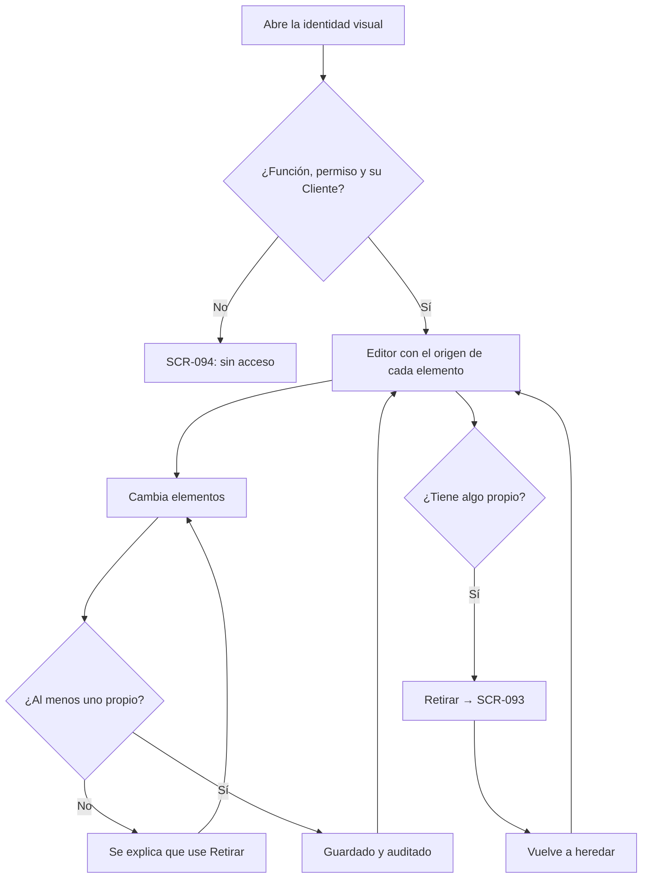

<!-- Ejemplo resumido de un flujo real del DSP-009 (Identidad visual del Cliente y base del
Producto). Muestra el modo CONTRASTAR (lo construido en US268) y cómo se reutilizan las ramas
del flujo del Distribuidor (FLW-004) en vez de copiarlas. -->

# FLW-052 — Personalizar la identidad visual del Cliente en Web Cliente

> **[Fuente]** historia, BR o DH · **[Reutiliza]** rama de FLW-004 que aplica igual · **[Construido]** observado en US268, no aprobado · **[PENDIENTE: ID]** rama con pregunta abierta.
> El flujo identifica pasos, estados y ramas. El layout y los textos finales son de `ui-spec-writer`.

## En 30 segundos

El Administrador del Cliente abre «Ajustes › Identidad visual», ve de quién hereda cada elemento,
cambia uno o más y guarda. Para volver a lo heredado usa **Retirar**, que solo aparece si tiene
algo propio. Las ramas de edición y errores son las de FLW-004.

## 1. Propósito y alcance

Que los usuarios del Cliente vean la marca de su empresa (HU-01-14 §2). El ingreso con la marca
del Distribuidor es de FLW-002; este flujo no lo redibuja.

## 2. Actor, plataformas y permisos

| Dato | Valor | Fuente |
|---|---|---|
| Actor | Administrador del Cliente | HU-01-14 AC-1, AC-6 |
| Plataforma y entrada | Web Cliente, «Ajustes › Identidad visual» | [Construido] US268 |
| Flujo base reutilizado | FLW-004 (identidad del Distribuidor) | DH-1523 |

## 3. Supuestos y decisiones que condicionan el flujo

- Herencia por elemento: Cliente → Distribuidor → Producto (AC-9; BR-241).
- Un valor igual al heredado no cuenta como propio (HU-01-14-Q2 d).

## 4. Pantallas declaradas (FLW → SCR)

| SCR | Nombre propuesto | Qué cubre | Base |
|---|---|---|---|
| SCR-092 | Editor con vista previa | Elementos con su origen, edición y guardar | SCR-011 |
| SCR-093 | Confirmación del retiro | Efecto del retiro y cambios sin guardar | SCR-012 |
| SCR-094 | Acceso no autorizado | Sin permiso, otro Cliente o función no habilitada | SCR-013 |

## 5. Camino feliz

| Paso | Actor o sistema | Acción | Resultado | Fuente |
|---|---|---|---|---|
| P1 | Administrador | Abre la identidad visual | Cargando | [Construido] |
| P2 | Sistema | Verifica función, permiso y Cliente; resuelve la identidad | Heredada, parcial o total | AC-6 |
| P3 | Administrador | Cambia uno o más elementos | Sin guardar | AC-1; [Reutiliza] FLW-004 P4 a P8 |
| P4 | Sistema | Valida al menos un propio, guarda y audita | Guardado, cada elemento con su origen | AC-1, AC-7 |

### Camino alterno: retirar

| Paso | Actor o sistema | Acción | Resultado | Fuente |
|---|---|---|---|---|
| R1 | Administrador | Con algo propio, activa Retirar | Se abre SCR-093 | AC-4, AC-10 |
| R2 | Sistema | Explica a qué vuelve y que no cambia permisos | Confirmación con foco en Cancelar | AC-4, AC-5 |
| R3 | Sistema | Retira y audita | Todo heredado; Retirar deja de mostrarse | AC-4, AC-7 |

## 6. Ramas, excepciones y permisos

| ID | Condición | Tratamiento | Fuente o estado |
|---|---|---|---|
| C-01 | Guardar sin ningún elemento propio | No se guarda; se explica que use Retirar | HU-01-14-Q5 |
| C-02 | No es Administrador del Cliente u otro Cliente | SCR-094; no se muestra el editor | AC-6; BR-017 |
| C-08 | ¿Se pierden los valores propios al retirar? | El diálogo dice que deja de usarlos | [PENDIENTE: UXR-140-Q1] |

### Reutilizadas de FLW-004

| Rama de origen | Qué cubre | Diferencia en el Cliente |
|---|---|---|
| X-13, X-14, X-15 | Error al guardar, salir con cambios, doble envío | Igual |

## 7. Estados del flujo

| Estado | Qué significa | Fuente |
|---|---|---|
| Heredada | Ningún elemento propio; Retirar no se muestra | AC-9, AC-10 |
| Parcial o total | Al menos uno propio; Retirar disponible | AC-9, AC-10 |

## 8. Diagrama

## 9. Trazabilidad

- Historia: HU-01-14, AC-1 a AC-10.
- Requisitos: UXR-140 (propio); UXR-010 y UXR-012 (reutilizados).
- Construido: `microui-monitoring`, `src/app/features/identidad-visual/` (US268).

## 10. Accesibilidad

El origen de cada elemento se dice con texto; el diálogo de retiro atrapa y devuelve el foco.

## 11. Preguntas abiertas que afectan al flujo

| ID | Rama | Responsable | Bloquea |
|---|---|---|---|
| UXR-140-Q1 | C-08 | Product Owner | No |

# Historial

| Fecha | Cambio |
|---|---|
| 2026-11-26 | Versión inicial (DSP-009, IDV-UX · 02) sobre FLW-004 y lo construido en US268 |
