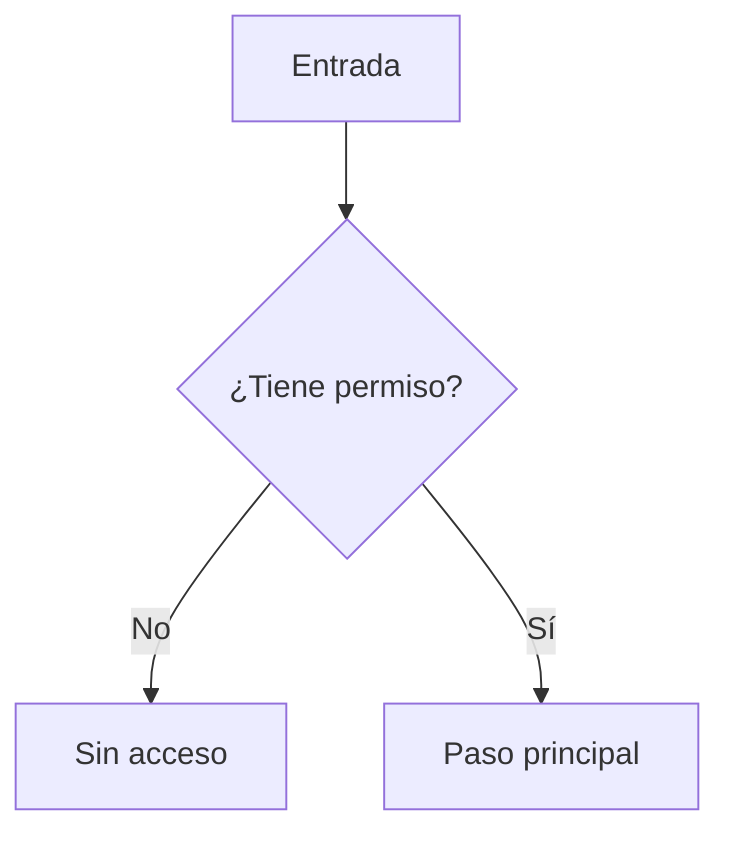

# FLW-NNN — <verbo + qué logra el usuario>

> **[Fuente]** historia, BR o DH · **[Reutiliza]** rama de otro flujo que aplica igual · **[Construido]** observado en lo construido, no aprobado · **[Inferencia]** deducido · **[PENDIENTE: ID]** rama con pregunta abierta; no se resuelve aquí.
> El flujo identifica pasos, estados y ramas. El layout y los textos finales son de `ui-spec-writer` y UX writing.

## En 30 segundos

<El recorrido en un párrafo y la rama que más importa.>

## 1. Propósito y alcance

<Qué logra el actor. Qué queda fuera y en qué flujo vive.>

## 2. Actor, plataformas y permisos

| Dato | Valor | Fuente |
|---|---|---|
| Actor |  |  |
| Plataforma y entrada |  |  |
| Permiso |  |  |
| Flujo base reutilizado |  |  |

## 3. Supuestos y decisiones que condicionan el flujo

- 

## 4. Pantallas declaradas (FLW → SCR)

| SCR | Nombre propuesto | Qué cubre | Base |
|---|---|---|---|
| SCR-NNN |  |  |  |

## 5. Camino feliz

| Paso | Actor o sistema | Acción | Resultado | Fuente |
|---|---|---|---|---|
| P1 |  |  |  |  |

## 6. Ramas, excepciones y permisos

| ID | Condición | Tratamiento | Fuente o estado |
|---|---|---|---|
| P-01 | Sin permiso o de otro inquilino |  |  |
| X-01 | Error al guardar |  |  |
| C-01 |  |  | [PENDIENTE: UXR-NNN-Q1] |

## 7. Estados del flujo

| Estado | Qué significa | Fuente |
|---|---|---|
| Cargando |  |  |
| Vacío |  |  |
| Error |  |  |
| Sin permiso |  |  |
| Éxito |  |  |

## 8. Diagrama

## 9. Trazabilidad

- Historia: HU-NN-NN, AC-N.
- Requisitos: UXR-NNN.
- Flujos relacionados: 
- Construido: <repo, rama y ruta, si aplica>.
- Tarea: 

## 10. Accesibilidad

<Foco, avisos y teclado a lo largo del recorrido; remite al UXR de accesibilidad.>

## 11. Preguntas abiertas que afectan al flujo

| ID | Rama | Responsable | Bloquea |
|---|---|---|---|
| UXR-NNN-Q1 | C-01 | Product Owner | No |

# Historial

| Fecha | Cambio |
|---|---|
| AAAA-MM-DD | Versión inicial (DSP-NNN, <tarea>) |
