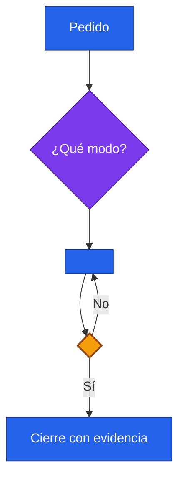

> <b>Antes de leer:</b> ¿<pregunta cuya respuesta está en la página>?

## En 30 segundos

1. <Qué hace, en una línea.>
2. <Cómo trabaja: su control principal.>
3. <Qué no hace o qué decide la persona.>

## Cuándo usarlo y para qué

| Si necesitas… | Pídelo así | Obtienes |
| --- | --- | --- |
| <necesidad> | "<frase que lo activa>" | <resultado> |

<b>No lo uses para:</b> <lo que deriva a otro skill y a cuál>.

## Cómo llamarlo

- <b>En Claude Code:</b> <code>/<nombre></code> seguido del pedido, o una frase de la tabla.
- <b>En Codex:</b> menciónalo por su nombre en el pedido.
- <b>Requisitos:</b> <tokens o accesos, sin pedir nunca un secreto en el chat>.

## Cómo funciona por dentro

En el diagrama, <b>naranja</b> son los controles que frenan el trabajo, <b>morado</b> las decisiones, <b>azul</b> el trabajo del skill y <b>verde</b> lo opcional o lo que ve el equipo.

<b>Paso a paso, en palabras simples:</b>

1. <paso>

## Sus guías internas

| Guía | Cuándo la lee | Para qué |
| --- | --- | --- |
| <code><archivo>.md</code> | <paso> | <para qué> |

Además trae <templates, examples, scripts, tests y evals, con cantidades>.

## Cómo no perder el contexto

- <práctica concreta para retomar>

## Recursos operativos

- Fuente canónica: [Skills-Privado](https://github.com/iamacalupuenzo-ui/Skills-Privado/tree/main/skills/<nombre>).
- PR de la versión actual: [#<n>](<url>).
- Herramientas externas: <lista>.

## Versión operativa

<Qué cambió en esta versión y la última verificación con su fecha. El número vive en la propiedad Versión.>

## Comprueba

¿<pregunta de comprobación>?
